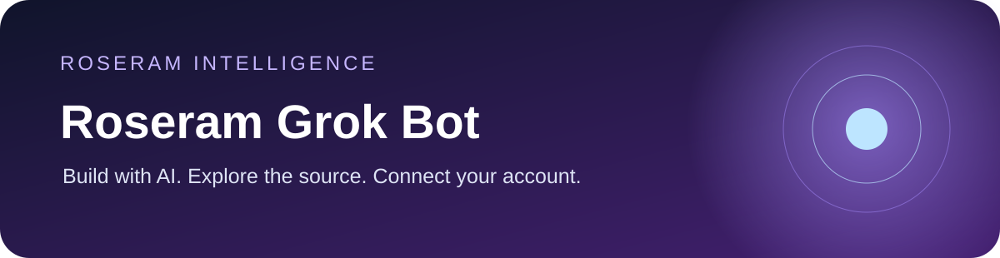

<h1 align="center">Roseram Grok Bot</h1>

Build, learn and explore AI-powered workspaces with Roseram.

[Launch web workspace](https://roseram.com/downloads/grok-bot?run=1) · <a href="https://roseram.com/">Website</a> · <a href="https://roseram.com/developers">Developer API</a> · <a href="https://github.com/roseramintelligence/roseram-grok-bot/issues">Issues</a>

  

> If this project is useful to you, consider starring it, sharing feedback, or contributing through a pull request.

## About this project

A multi-file Roseram project workspace and desktop client. This is an independent Roseram project, not an official application from another AI or editor vendor. Existing upstream integrations and their licenses remain in `upstream/`.

## Run the local application

Requires Node.js 22 or later. Run `npm start`, then open the printed loopback URL. The editor, projects, imports, exports and HTML preview work without an account. Connect a Roseram developer key for model requests; the key stays in memory and is sent only to the local gateway and Roseram API. Developer API access and credits are required. `ROSERAM_API_KEY` can also be provided in the server environment. Never commit a key.

## Workspaces

Open up to 200 text files with a combined size of 2 MB. Private environment files, keys, build folders and binaries are excluded. Ask questions, request a plan, or choose Edit to receive complete-file proposals. Review proposals before applying them. Stale file baselines and unsupported paths are rejected. No generated code is automatically executed. Local API requests include a bounded selection of up to 12 files / 48,000 characters. Conversations, drafts and working copies are saved in this browser; export a project for a separate copy.

The hosted account-connected application is [roseram.com/downloads/grok-bot?run=1](https://roseram.com/downloads/grok-bot?run=1). It uses the existing Roseram account, billing and generation-job services. This local package uses developer API credentials instead.

## Windows desktop source

`cd desktop`, `npm ci`, then `npm start` or `npm run build:windows`. The desktop client opens the hosted Roseram workspace, adds native folder selection, saves with backups and explicit approval, and executes approved project commands with real exit statuses and bounded output. Internet access is needed to load the hosted UI and use models. Native tools are restricted to the trusted top-level workspace; renderer Node integration is disabled.

Unsigned builds are development candidates. Production installers require platform signing and a verified release. Automatic updates continue to require signed release metadata and OS verification. macOS production builds additionally require a macOS runner, signing and notarization; no macOS acceptance is implied by a Windows build.

## Build and checks

Run `npm ci`, `npm run build`, and `npm test` to rebuild the bundled React application and run its core, HTTP and native integration tests. The committed bundle lets end users run `npm start` without a toolchain installation. Tests use synthetic keys and mocked model responses; a paid live model response is a separate acceptance check. Native integration tests use mocked approval dialogs and real temporary files / commands.

`application-src/` contains the complete UI and its frontend dependencies. `src/workspace-server.mjs` is the loopback-only model gateway; `desktop/` contains the native client. The original CLI and API helpers remain available, with the previous entry point under `npm run legacy`.

## Explore the Roseram ecosystem

| Project | Purpose |
| --- | --- |
| [Roseram Codex](https://github.com/roseramintelligence/roseram-codex) | Local AI project workspace and desktop client |
| [Roseram Claude Code](https://github.com/roseramintelligence/roseram-claude-code) | Local AI project workspace and desktop client |
| [Roseram Grok Bot](https://github.com/roseramintelligence/roseram-grok-bot) | Local AI project workspace and desktop client |
| [Roseram Cursor](https://github.com/roseramintelligence/roseram-cursor) | Local AI project workspace and desktop client |
| [Roseram Preview](https://github.com/roseramintelligence/roseram-preview) | Product interface preview |

## Get involved

- Browse the source and open issues for reproducible bugs or feature ideas.
- Submit focused pull requests with context and verification details.
- For security-sensitive reports, contact [support@roseram.com](mailto:support@roseram.com) privately; do not include credentials or customer data in public issues.
- See the repository's license and upstream notices before redistributing.

The Roseram hosted service and its API are separate from the public client source. Account eligibility, credits, and service availability apply to hosted model requests.
